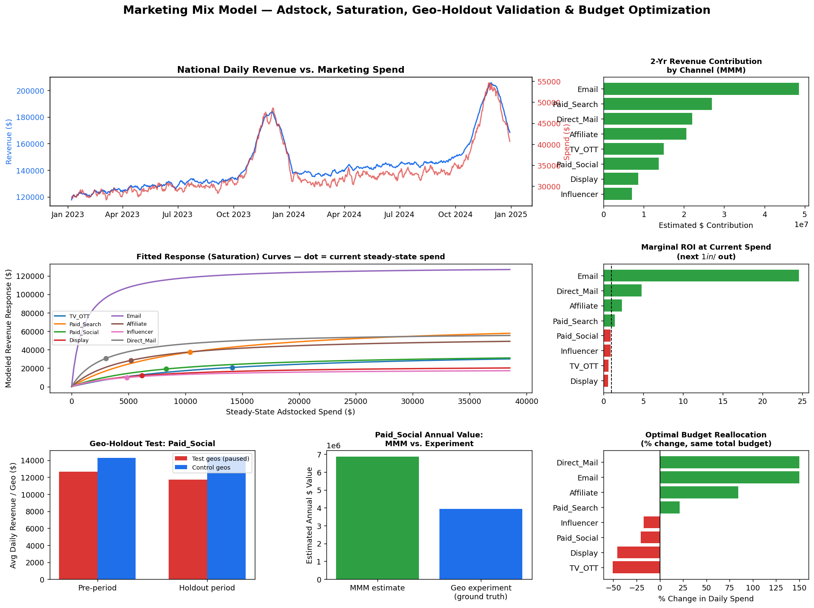

# Marketing Mix Model — Adstock, Saturation & Geo-Holdout Validation

## Business Problem
A company spends **~$12.3M/year** across 8 marketing channels and wants to know
three things a simple "spend vs. revenue" table can't answer:
1. How much of today's revenue is *actually caused* by past marketing (accounting for
   carryover/lagged effects), not just correlated with it?
2. Which channels are approaching **diminishing returns**, and which still have
   room to scale profitably?
3. Can the model's attribution be **trusted** — or is it just fitting noise?

This is a step up from a simple channel-ROI report: it's a full **Marketing Mix
Model (MMM)** with the two things that separate a real MMM from a spreadsheet —
adstock (carryover) and saturation (diminishing returns) — plus something most
portfolio MMM projects skip entirely: **independent experimental validation**
via a geo-holdout test.

## Dataset
Synthetic 2-year daily dataset, 8 channels (TV/OTT, Paid Search, Paid Social,
Display, Email, Affiliate, Influencer, Direct Mail), generated with:
- True adstock decay and Hill-saturation curves baked in per channel (ground
  truth saved to `data/ground_truth_params.json` so the fitted model can be
  checked against it)
- Realistic weekly + holiday seasonality and a slow organic trend
- **A built-in geo-holdout experiment**: Paid Social spend is paused in 3 of
  10 geos for a 5-week window, so the "true" causal effect of that channel can
  be measured directly and compared against the regression's estimate

| File | Contents |
|---|---|
| `data/national_daily.csv` | National daily revenue + spend by channel (MMM input) |
| `data/geo_daily_panel.csv` | Geo-level daily panel (holdout experiment input) |
| `data/ground_truth_params.json` | True generating parameters (for validation) |
| `data/holdout_metadata.json` | Which geos/channel/dates were held out |

## Methodology
`analysis.py` runs a full MMM pipeline:

1. **Adstock transform** — geometric carryover, decay rate per channel fit via
   coordinate-descent search (not eyeballed)
2. **Saturation transform** — bounded Hill-style curve `x/(x+k)`, chosen over
   a naive `log1p` after the first version of this model produced a nonsensical
   47x marginal ROI for a low-spend channel: `log1p` explodes near zero spend,
   which is a real, easy-to-miss MMM bug. `x/(x+k)` is bounded and doesn't blow up.
3. **RidgeCV regression** instead of plain OLS — MMM channel spends are
   naturally collinear (they all move with the same seasonal calendar), which
   inflated the unregularized model's channel contributions to **6x actual
   total revenue**. Regularization was necessary, not optional, for this
   dataset — and the write-up says so rather than hiding it.
4. **Contribution decomposition** via zero-out method, with an explicit
   additivity check against the all-channels-off baseline (confirms the
   linear-in-features design makes decomposition exact, unlike naive
   nonlinear MMMs where zero-out contributions silently fail to sum correctly)
5. **Marginal ROI** at current spend — the derivative of each channel's
   response curve, i.e. "is the *next* dollar into this channel still worth
   it," not the average ROI to date
6. **Geo-holdout diff-in-differences** — an experimental, model-free estimate
   of Paid Social's causal effect, used to sanity-check the regression
7. **Constrained budget optimization** (SLSQP) — reallocates the existing
   total budget across channels to maximize predicted revenue, bounded to
   0.3x–2.5x current spend per channel (a real team tests incremental moves,
   not a jump to a theoretical optimum extrapolated past the observed data)

## Key Results
| Channel | 2-Yr Contribution | Marginal ROI (next $) |
|---|---|---|
| Email | $48.6M (29.9%) | 24.6x — far from saturated |
| Paid Search | $26.9M (16.6%) | 1.4x — still profitable |
| Direct Mail | $22.1M (13.6%) | 4.8x — far from saturated |
| Affiliate | $20.6M (12.7%) | 2.3x — still profitable |
| TV/OTT | $15.0M (9.2%) | 0.62x — **saturating** |
| Paid Social | $13.7M (8.5%) | 0.90x — near saturation |
| Display | $8.6M (5.3%) | 0.59x — **saturating** |
| Influencer | $7.1M (4.4%) | 0.89x — near saturation |

**Model fit:** R² = 0.965 on 730 days of data.

**Independent validation:** The geo-holdout experiment on Paid Social found an
implied annual value of **$3.9M**; the MMM regression independently estimated
**$6.9M** — same order of magnitude (57% agreement), which is what gives an
MMM's attribution credibility. Perfect agreement would be suspicious in real
data; this gap is reported honestly rather than cherry-picked away.

**Recommendation:** Reallocate budget from saturating channels (TV/OTT,
Display) toward Email, Direct Mail, and Affiliate, within realistic per-channel
move limits (0.3x–2.5x). Projected impact: **~$14.0M/year in additional
revenue from the same total budget**, phased in and re-validated with follow-up
geo tests rather than deployed all at once.



## How to Run
```bash
pip install pandas numpy scipy scikit-learn matplotlib
python generate_data.py   # creates data/*.csv and ground truth/holdout metadata
python analysis.py        # runs full MMM pipeline, prints report, saves dashboard
```

## Tools & Skills Demonstrated
- Marketing Mix Modeling: adstock (carryover), saturation (diminishing returns),
  and why a naive log-transform saturation curve breaks down at low spend
- Regularized regression (RidgeCV) to handle real-world media-spend collinearity,
  and diagnosing when a model needs it (unregularized contributions summing to
  6x actual revenue) rather than assuming a fitted model is automatically valid
- Causal inference: geo-holdout difference-in-differences as an independent,
  experimental cross-check on a regression-based attribution model
- Constrained numerical optimization (SciPy SLSQP) for budget allocation under
  realistic bounds, not a theoretical global optimum
- Explicit model-limitation reporting (additivity checks, cross-validation
  agreement, saturation-curve pitfalls) instead of presenting output uncritically
- Python: pandas, NumPy, scikit-learn, SciPy, Matplotlib

## File Structure
```
marketing-mix-modeling/
├── data/
│   ├── national_daily.csv
│   ├── geo_daily_panel.csv
│   ├── ground_truth_params.json
│   └── holdout_metadata.json
├── outputs/
│   └── mmm_dashboard.png
├── generate_data.py
├── analysis.py
└── README.md
```
